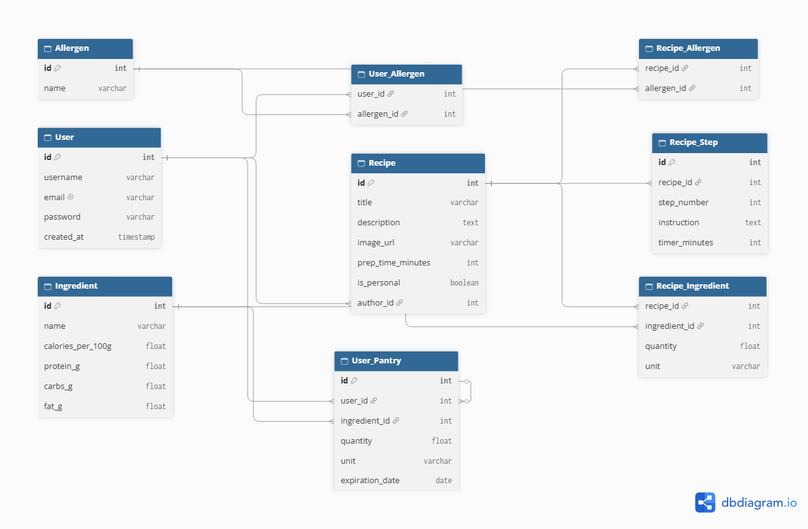

# Simmer

> **Smart Pantry Cooking** — A culinary mobile assistant designed to manage household pantry inventory, suggest matching recipes, and guide the cooking process in real time.

---

## Overview & Key Features

- **Pantry Management:** Track ingredients, quantities, and availability in real time.
- **Recipe Discovery:** Suggest recipes based on available pantry items, with filtering by preparation time, ingredient match percentage, and dietary restrictions/allergens.
- **Smart Cooking Mode:** Checklist-style preparation steps with inline cooking timers and screen keep-awake functionality.
- **Dynamic Portioning & Nutrition:** Automated scaling of ingredient quantities and macronutrient breakdown per serving.

---

## Tech Stack

- **Frontend:** React Native / Expo
- **Backend:** Java 25 & Spring Boot 4 (Spring Data JPA, Spring Web)
- **Database:** PostgreSQL (Hibernate ORM)
- **Design & Wireframes:** Figma

---

## UI/UX Wireframes

Explore the early design concepts and screen flows on Figma:  
👉 [Simmer Figma Wireframes](https://www.figma.com/design/j8o6qDjGQoYO08BXNyOVjv/Untitled?node-id=0-1&m=dev&t=2d4HF76FdQTYKg5u-1)

---

## 🗄 Database Architecture

